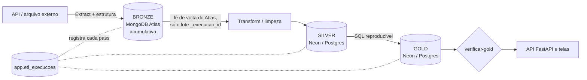

# APIs e ETL do ClimaSense

Padrão único para toda fonte de dados:



Regras: a bronze **nunca é apagada** (cada documento leva `_fonte`, `_execucao_id`, `_data_carga`); a silver é construída **somente** com o que foi lido de volta do Atlas; a gold é só SQL sobre a silver; cada execução grava `lidos/gravados/descartados/erro` em `app.etl_execucoes`, com mensagem sem segredos. Dado ausente fica `null`, nunca 0 (RN-02). Indicadores sobre extração parcial são rotulados **AMOSTRA** (RN-10).

## Fontes

| Fonte (id) | Endpoint / base | Credencial | Volume e limite | Cadência | Bronze (Atlas) | Silver (Neon) | Gold | Estado | CLI | Classe |
|---|---|---|---|---|---|---|---|---|---|---|
| `open-meteo-historico` | `https://archive-api.open-meteo.com/v1/archive` (ERA5) | nenhuma (uso não comercial; CC BY 4.0) | 8 pontos × horas; histórico completo 2021→hoje−7d ≈ 406 mil linhas; `atualizar` usa janela de 45 dias | diária | `bronze.open_meteo_historico` | `silver.observacoes` (`tipo=derivada`, sem repetir o que já existe) | `gold.chuva_diaria`, `chuva_mensal`, `referencia_mensal` | **real** | `etl run open-meteo-historico [--limite DIAS]` | `ConectorOpenMeteoHistorico` |
| `open-meteo-previsao` | `https://api.open-meteo.com/v1/forecast` | nenhuma | 8 pontos × 72 h = 576 linhas por emissão | 6 h | `bronze.open_meteo_previsao` | `silver.observacoes` (`tipo=prevista`, `emitido_em`, `horizonte_h`) | usada pelos cenários (sem tabela gold própria) | **real** | `etl run open-meteo-previsao` | `ConectorOpenMeteoPrevisao` |
| `open-meteo-mare` | `https://marine-api.open-meteo.com/v1/marine` | nenhuma | 1 ponto × 72 h | diária | `bronze.open_meteo_mare` | `silver.observacoes` (`mare_m`, prevista) | cenários | **real** | `etl run open-meteo-mare` | `ConectorOpenMeteoMare` |
| `territorio-oficial` | downloads em `https://dados.recife.pe.gov.br/dataset/…` (GeoJSON distritos, CSV bairros, GeoJSON faixas hídricas); cópia íntegra em `data/territorio/` | nenhuma | 8 distritos, 94 bairros, 81 faixas | anual | `Recife.DistritosSanitarios`, `Recife.FaixasHidricas` (upsert, não apaga) | `app.territorios` (103 linhas: Recife + 8 + 94), lida de volta do Atlas | — | **real** | `python -m climasense.territorio carregar [--baixar]` | `territorio.carga` |
| Mapa (tiles) | `MAP_TILES_URL` (padrão ArcGIS World Light Gray Base) | nenhuma | tiles sob demanda, só no navegador | — | — | — | — | **real** (não é ETL) | — | — |
| `apac-chuva` | `https://api.apac.pe.gov.br/api.php` (`/precipitacao_acumulada?municipio=Recife`; histórico em `/historico_pluviometrico_mensal?tipo=diario`) | nenhuma | 19 pluviômetros no Recife (APAC + Cemaden), acumulados de 1 h a 120 h; histórico diário mês a mês desde 2022 (59 consultas) | 10–15 min (`tempo-real`); histórico: janela de 2 meses no `atualizar` | `bronze.apac_chuva`, `bronze.apac_chuva_historico` | `silver.estacoes`, `silver.apac_chuva_leituras`, `silver.apac_chuva_diaria` | `gold.chuva_apac_agora`, `gold.chuva_apac_diaria` (bairro, distrito, Recife; máx. e mediana; herança marcada) | **real** | `etl run apac-chuva [--modo historico [--limite MESES]]` | `ConectorApacChuva` |
| `alertas-oficiais` | APAC `/alertas`, INMET `apiprevmet3.inmet.gov.br/avisos/ativos`, Cemaden `painelalertas.cemaden.gov.br/wsAlertas2`, IDAP `idapfile.mdr.gov.br/idap/api/rss/cap` (CAP 1.2) | nenhuma | IDAP ~15 MB por consulta; a bronze guarda só o que toca PE + resumo (sha256) | 10–15 min | `bronze.alertas_oficiais` | `silver.alertas_oficiais` (upsert por origem + código) | lida por `estagios.alertas_oficiais` | **real** | `etl run alertas-oficiais` | `ConectorAlertasOficiais` |
| `recife-alagamento` | CKAN `registro-de-atendimentos-da-defesa-civil` (um CSV por ano) | nenhuma | ~890 mil atendimentos 2014–2024 (150 MB); 1.722 de alagamento | conjunto histórico; `atualizar` repete a cada 7 dias | `bronze.recife_alagamento` (resumo de cada arquivo + linhas que citam "alag") | `silver.ocorrencias` (`tipo=alagamento`, carga completa da fonte) | `gold.alagamento_bairro_dia` | **real** (rótulo fraco) | `etl run recife-alagamento` | `ConectorRecifeAlagamento` |
| `inmet` | `https://apitempo.inmet.gov.br/estacao/{ini}/{fim}/A301` | token INMET | — | 6 h | `bronze.inmet` | `silver.observacoes` (`chuva_mm`, `temp_c`) | chuva | planejado: sem token a API devolve 204 a qualquer consulta (verificado em 24/10/2026) | `etl run inmet` | `ConectorInmet` |
| `ana-telemetria` | HidroWebService (ANA) | usuário e senha ANA (`ANA_USUARIO`, `ANA_SENHA`) | — | 6 h | `bronze.ana_telemetria` | `silver.observacoes`/`estacoes` (`chuva_mm`, `nivel_m`) | chuva | planejado: exige cadastro | `etl run ana-telemetria` | `ConectorAnaTelemetria` |
| `cemaden` | pluviômetros automáticos (Cemaden) | cadastro | — | 10 min | `bronze.cemaden` | `silver.observacoes` | chuva | planejado: as estações do Cemaden no Recife já chegam pelo `apac-chuva` e os alertas pelo `alertas-oficiais`; a série própria exige cadastro | `etl run cemaden` | `ConectorCemaden` |
| `mare-marinha` | tábua de maré do Porto do Recife (CHM/Marinha) | nenhuma, mas só PDF/HTML | 1 porto | mensal | `bronze.mare_marinha` | `silver.observacoes` (`mare_m`) | cenários | planejado: sem formato estruturado | `etl run mare-marinha` | `ConectorMareMarinha` |

Os dicionários de cada fonte estão em [`dicionario-dados/`](dicionario-dados/README.md). Fontes planejadas falham com a mensagem “Conector planejado” e **nunca geram dados**.

**Fonte retirada em 06/11/2026:** `recife-abrigos` (cadastro do CKAN, lista curada e feed de abrigos ativos do COP)
saiu do produto (PRD v3, ADR 0016). O conector, a pasta `data/abrigos/` e as tabelas `app.abrigos` e
`app.abrigo_atualizacoes` (migração 0019) foram removidos. As coleções `bronze.recife_abrigos` e
`bronze.recife_abrigos_ativos` no Atlas não recebem mais cargas e não são apagadas pelo ETL (destino em P-31).

## Comandos

Dentro de `backend` (ou `.\.venv\Scripts\python` na raiz):

```powershell
python -m climasense.territorio carregar                         # 1. território (idempotente)
python -m climasense.etl run open-meteo-historico                # 2. histórico ERA5 completo (~9 min)
python -m climasense.etl run open-meteo-previsao                 #    previsão 72 h + 7 dias passados do modelo
python -m climasense.etl run open-meteo-mare
python -m climasense.etl run apac-chuva --modo historico         # 3. chuva diária por estação desde 2022 (~2 min)
python -m climasense.etl run recife-alagamento                   # 4. Defesa Civil 2014–2024 (baixa ~150 MB)
python -m climasense.etl tempo-real                              # APAC agora e alertas oficiais
python -m climasense.etl verificar-gold                          # ou: python scripts/verificar_gold.py
python -m climasense.etl atualizar [--forcar] [--sem-territorio] # tudo, em ordem
```

`atualizar` roda: território → Open-Meteo histórico (janela móvel de 45 dias) → previsão → maré → APAC tempo real → APAC histórico (últimos 2 meses) → alertas oficiais → InfoDengue → conjuntos periódicos (alagamento e deslizamento, SINAN leptospirose, arboviroses por bairro; pulados se já carregados há menos de `REPETIR_APOS_DIAS`; `--forcar` ignora) → `verificar-gold`. `tempo-real` roda só APAC e alertas. Os dois imprimem uma linha por passo (sucesso, falha ou pulado) e **saem com código 1 se qualquer passo falhar**; um passo que falha não impede os seguintes.

Regras das fontes do foco em chuvas:

- **Ausente ≠ zero.** "-"/null da APAC vira nulo. Leitura de estação com mais de 120 min em relação à coleta mais recente é **desatualizada**: fica fora da estatística do território, que herda do distrito ou do Recife, marcado em `herdado_de` (RN-07). No histórico, mês de estação com total < 10% da mediana das vizinhas (quando elas somam ≥ 30 mm) vira `falha`, e pico isolado (≥ 80 mm com as vizinhas quase secas) vira `suspeito`; os dois ficam nulos na gold e guardam `valor_bruto_mm`.
- **Chuva das últimas 24 h** (`servicos/estagios.chuva_24h`): prefere `gold.chuva_apac_agora` (maior acumulado de 24 h entre as estações atualizadas do distrito); sem ela, reanálise ERA5 e horas já passadas da previsão. `chuva_24h_fontes` diz qual foi usada.
- **Alertas**: só entram avisos com geocode IBGE 2611606, polígono que intercepta o Recife ou, na APAC, a mesorregião "Metropolitana de Recife". Vencidos na hora da coleta são descartados.

Carga real local de 04–05/11/2026 (Docker): Open-Meteo 408.576 horas (01/01/2021 → 29/10/2026), APAC 22 estações e 14.746 dias válidos (01/01/2022 → 04/11/2026), 1.722 atendimentos de alagamento (16/01/2014 → 25/06/2024, 461 bairro-dias) e 199 abrigos (fonte retirada em 06/11/2026). O IDAP é filtrado antes da bronze porque o feed nacional (~15 MB) a cada 15 min estouraria o plano gratuito do Atlas.

## Agendamento

Windows (Agendador de Tarefas), diariamente às 06:00:

```powershell
schtasks /Create /SC DAILY /ST 06:00 /TN "ClimaSense ETL" /TR "cmd /c cd /d C:\Users\rlc3\Documents\Projetos\ClimaSense\backend && ..\.venv\Scripts\python -m climasense.etl atualizar >> ..\tmp\etl.log 2>&1"
```

Windows, a cada 15 minutos (chuva observada e alertas):

```powershell
schtasks /Create /SC MINUTE /MO 15 /TN "ClimaSense ETL tempo real" /TR "cmd /c cd /d C:\Users\rlc3\Documents\Projetos\ClimaSense\backend && ..\.venv\Scripts\python -m climasense.etl tempo-real >> ..\tmp\etl-tempo-real.log 2>&1"
```

Linux / cron (`atualizar` 4 vezes ao dia mantém a previsão fresca; os conjuntos estáticos se auto-pulam):

```cron
0 */6 * * * cd /opt/climasense/backend && ../.venv/bin/python -m climasense.etl atualizar >> /var/log/climasense-etl.log 2>&1
*/15 * * * * cd /opt/climasense/backend && ../.venv/bin/python -m climasense.etl tempo-real >> /var/log/climasense-etl-tr.log 2>&1
```

O `.env` precisa estar na raiz do projeto. O código de saída diferente de zero permite alertar no agendador.
