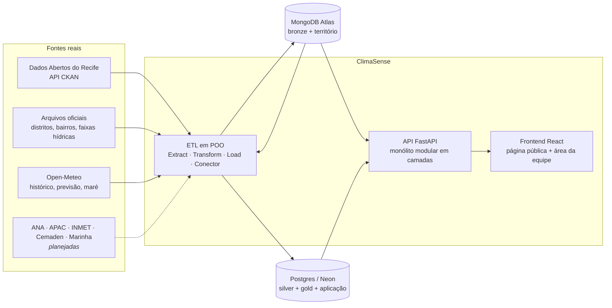
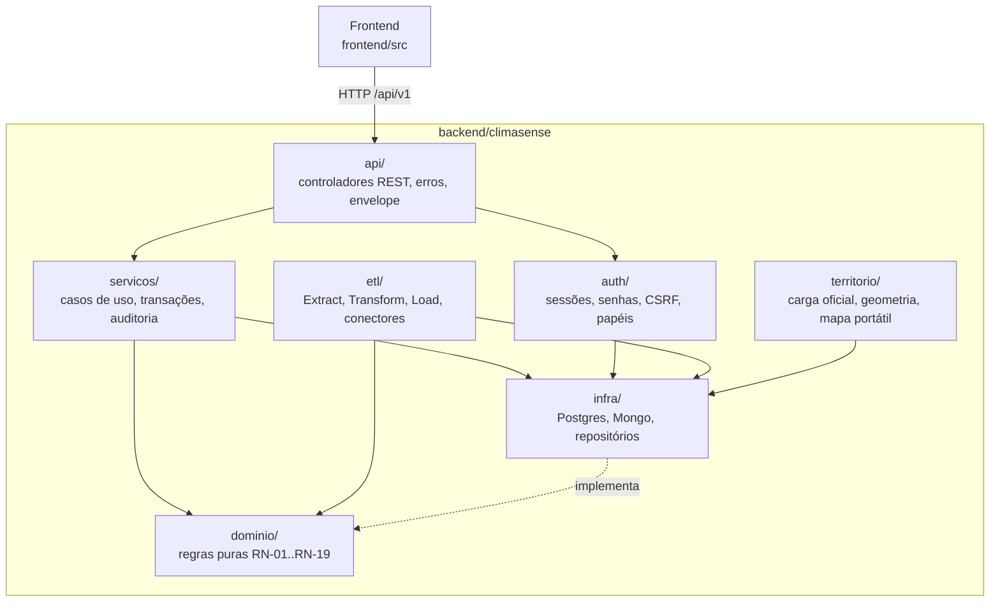
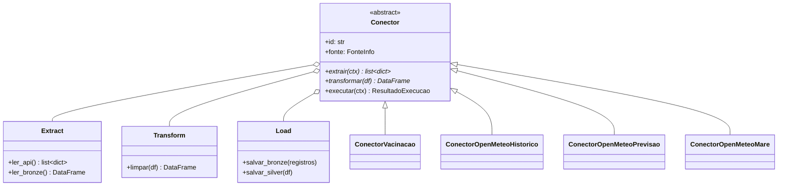

# Arquitetura do ClimaSense

Este documento descreve **como o sistema está organizado** e as regras que mantêm essa organização. A especificação completa está em [`specs/design.md`](../specs/design.md); as decisões e seus motivos, em [`docs/adr/`](adr/).

## 1. Visão geral



São **dois executáveis** (ADR 0001):

| Executável | O que faz | Como roda |
|---|---|---|
| **API** (`climasense.api.main:app`) | Atende o frontend: território, séries, cenários, avaliações, comunicados, login | `uvicorn`, sempre no ar |
| **ETL** (`python -m climasense.etl`) | Busca as fontes reais, grava bronze no Atlas e silver/gold no Postgres | Comando agendado (Agendador de Tarefas do Windows, cron ou GitHub Actions) |

Assim, uma fonte externa fora do ar nunca derruba a API: a tela mostra o último dado válido como “desatualizado” (RNF-CON-01).

## 2. Camadas



| Camada | Pacote | Pode importar | Não pode importar |
|---|---|---|---|
| Apresentação | `frontend/` | só a API (HTTP) | segredos, bancos |
| Controladores REST | `api/` | `auth`, `servicos`, `dominio` | regra de negócio própria |
| Autenticação | `auth/` | `infra`, `dominio` | `api` |
| Aplicação | `servicos/` | `dominio`, `infra` | `api`, FastAPI |
| **Domínio** | `dominio/` | só a biblioteca padrão do Python | FastAPI, SQLAlchemy, pymongo, pandas, requests, qualquer outra camada |
| Infraestrutura | `infra/` | `config`, `dominio` | `api` |
| ETL e Território | `etl/`, `territorio/` | `infra`, `dominio`, pandas, requests | `api` |

**A regra é verificada por teste**: `backend/tests/unit/test_arquitetura.py` lê os imports de cada arquivo e falha se o domínio depender de infraestrutura ou se a infraestrutura depender da API. Assim, uma violação aparece no CI e não depende de revisão manual.

### Por que o domínio é puro

As regras que mais importam ao produto (ausência de dado ≠ risco baixo, ninguém aprova o próprio texto, prioridade não é probabilidade) ficam em funções e classes sem banco e sem rede. Elas são testadas em milissegundos e não mudam quando trocamos o banco ou a fonte.

## 3. Módulos de negócio

| Módulo | Domínio | Serviço | Rotas | Marco |
|---|---|---|---|---|
| Saúde do sistema | — | — | `/health` | M2 ✅ |
| Autenticação e papéis | `papeis.py`, `bloqueio.py`, `senha.py` | `autenticacao.py`, `usuarios.py` | `/auth/*`, `/admin/usuarios` | M3 ✅ |
| Território | `territorio.py` | — (rotas finas sobre `territorio/`) | `/territorios/*`, `/publico/estado` | M4 ✅ |
| Fontes e qualidade | `qualidade.py` | `etl/execucao.py` | `/fontes`, `/etl` | M5 ✅ |
| Séries | `estatistica.py`, `series.py` | `series.py` | `/series/*` | M6 |
| Cenários | `cenario.py` | `cenarios.py` | `/cenarios` | M6 |
| Saúde agregada | `saude.py` | `saude.py` | `/saude/*` | M6 |
| Avaliações e comunicados | `fluxo_revisao.py` | `avaliacoes.py`, `comunicados.py` | `/avaliacoes`, `/comunicados`, `/publico` | M7 |

## 4. ETL orientado a objetos

O ETL preserva as classes do `Projeto-ETL_AVD`, como ensinado na disciplina, e acrescenta a classe abstrata `Conector`, que organiza cada fonte:



`executar()` é o método-modelo comum: extrai → grava a bronze (acumulativa, com `_execucao_id`) → transforma → grava a silver → registra a execução em `app.etl_execucoes`. Para adicionar uma fonte nova, crie uma subclasse de `Conector` e implemente `extrair` e `transformar`.

## 5. Dados

| Camada | Onde | Conteúdo |
|---|---|---|
| **Bronze** | MongoDB Atlas | Registro original da fonte + `_fonte`, `_execucao_id`, `_data_carga`. Nunca é apagada (RN-09). |
| **Território** | MongoDB Atlas, banco `Recife` | `DistritosSanitarios` (8 feições enriquecidas) e `FaixasHidricas` (81 feições) |
| **Silver** | Postgres, esquema `silver` | Dados tipados e limpos, com os metadados mínimos (fonte, tipo, horários, unidade, qualidade) |
| **Gold** | Postgres, esquema `gold` | Agregados prontos para as telas, recalculáveis a partir da silver (CA-04) |
| **Aplicação** | Postgres, esquema `app` | Usuários, sessões, territórios, fontes, execuções, avaliações, comunicados, revisões, auditoria |

As migrações em `backend/migrations/versions/` são a fonte da verdade do Postgres. Algumas regras de negócio também são garantidas **no banco**, além do código:

- RN-05: um trigger impede o autor de revisar a própria versão.
- Um comunicado publicado precisa ser a versão aprovada (constraint).
- A auditoria aceita só inclusões: triggers barram UPDATE, DELETE e TRUNCATE (RF-14.2).
- Uma previsão sem horário de emissão é recusada, e o agregado suprimido não guarda valor (RN-13).
- `valor` nulo e `valor = 0` são distintos (RN-02).

## 6. Segurança

| Tema | Como |
|---|---|
| Segredos | Só no `.env` (fora do Git). `SecretStr` na configuração: não aparecem em logs nem em `repr`. Gitleaks no pre-commit e no CI. |
| Sessão | Token aleatório no cookie `HttpOnly`; só o hash fica no banco; expira após 60 min sem uso; revogável. |
| CSRF | Double-submit: cookie `cs_csrf` + cabeçalho `X-CSRF-Token` em toda alteração. |
| Senhas | Argon2id (`pwdlib`). Bloqueio de 15 min após 5 erros em 15 min. |
| Autorização | Papéis verificados no backend em toda rota (`exige_papel`). Um teste cobre a matriz rota × papel. |
| Erros | `application/problem+json` em português, sem pilha e sem string de conexão. |
| Cabeçalhos | CSP, `nosniff`, `X-Frame-Options: DENY`, `Referrer-Policy`, HSTS em produção. |

## 7. Execução e ambientes

| Ambiente | `AMBIENTE` | Bancos |
|---|---|---|
| Desenvolvimento | `desenvolvimento` | Atlas + Neon (branch de desenvolvimento) ou Postgres do `docker-compose.yml` |
| Testes automatizados | `teste` | Postgres descartável (`DATABASE_URL_TESTE`) e mongomock para o Atlas |
| Produção | `producao` | Atlas + Neon |

Em produção, a API serve o build do frontend num único processo. O ETL roda agendado.

## 8. Mapa de pastas do backend

```text
backend/
├── climasense/
│   ├── config.py            configuração (.env) com segredos protegidos
│   ├── api/                 main.py, deps.py, erros.py, envelope.py, seguranca.py, routers/
│   ├── auth/                senhas, sessões, CSRF, papéis, bloqueio
│   ├── dominio/             regras puras (recorte, papéis, … fluxo de revisão)
│   ├── servicos/            casos de uso
│   ├── infra/               postgres.py, mongo.py, modelos_sql.py, repositorios/
│   ├── etl/                 extract.py, transform.py, load.py, conectores/, gold/*.sql
│   ├── territorio/          carga oficial, geometria, mapa portátil
│   └── modelos/             interface do estimador de alagamento
├── migrations/versions/     0001 app · 0002 silver e gold · 0003 auditoria · 0004 fontes
└── tests/                   unit/ (sem banco) · integration/ (Postgres real)
```
