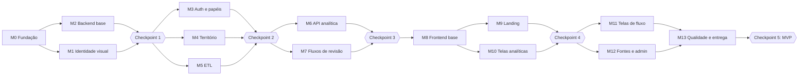

# ClimaSense — Plano de Tarefas (`tasks.md`)

| Campo | Valor |
|---|---|
| Fase SDD | 3 de 4 — Tarefas (passos pequenos e verificáveis) |
| Versão | 0.2 — aprovada em 15/10/2026 e revisada: somente dados reais; ETL em POO |
| Data | 15/10/2026 |
| Entradas | `requirements.md` v0.2 · `design.md` v0.2 |
| Objetivo da entrega | **Todas as telas do frontend prontas e o backend existente (ETL + território no Atlas) unido e completo**, usando **somente dados reais**. Onde uma fonte ainda não estiver integrada, a tela mostra “Dados insuficientes”. |

---

## 1. Como ler e executar este plano

**Formato de cada tarefa**

| Coluna | Significado |
|---|---|
| ☐ / ☑ | Estado. Quem executar marca ☑ quando o critério “Pronto quando” for verificado. |
| ID | `T<marco>.<n>`. Também é o prefixo da mensagem de commit (ex.: `T4.2: carga territorial no Atlas`). |
| Pronto quando | Verificação objetiva: comando, teste ou inspeção. Sem ela, a tarefa não está pronta. |
| Req | Requisitos e regras atendidos (`requirements.md`). |
| Dep | Tarefas que precisam estar prontas antes. |
| Tam | **P** até 2 h · **M** até 4 h · **G** até 1 dia. Nenhuma tarefa passa de 1 dia; se passar, quebre em duas. |

**Regras para quem executar (pessoa ou agente de IA)**

1. Leia a tarefa, os requisitos citados e a seção do `design.md` correspondente **antes** de escrever código.
2. Quando houver critério testável, escreva o teste primeiro.
3. Uma tarefa por commit. Mensagem: `T<id>: <o que mudou>`.
4. **Nunca** altere `Projetos/AVD`, `Desktop/AVD` nem `Desktop/Projeto-ETL_AVD`. Copie e adapte para `ClimaSense/`.
5. **Nunca** escreva segredos em código, testes, logs ou documentação. Só `.env` (fora do Git) e `.env.example` (sem valores).
6. Textos da interface seguem o design §8.9: caixa de frase, verbo de ação e vocabulário fixo.
7. Se a tarefa revelar um problema na especificação, **pare** e registre a dúvida no fim deste arquivo (seção 5) em vez de improvisar.
8. Ao fim de cada **checkpoint**, pare, mostre o resumo e as evidências (testes, capturas de tela) e aguarde aprovação.

**Marcos e checkpoints**

M1 (identidade) corre em paralelo ao backend desde o início, para que as telas nasçam já com a marca, e não com um tema provisório.

---

## 2. Tarefas

### M0 — Fundação do repositório

| ☐ | ID | Tarefa | Pronto quando | Req | Dep | Tam |
|---|---|---|---|---|---|---|
| ☑ | T0.1 | Criar a árvore de pastas do design §4 e o `README.md` com as seções: visão, como rodar (PowerShell e bash), estrutura, links para `specs/`. | A árvore confere com o design §4. O README abre e os links funcionam. | RNF-MAN-06 | — | P |
| ☑ | T0.2 | `.gitignore` (`.env`, `.venv`, `node_modules`, `dist`, `__pycache__`, `tmp`) e `.env.example` com todas as variáveis do design §10.1, sem valores reais. | `git check-ignore .env` retorna `.env`. O `.env.example` não tem nenhum valor real. | R-04, RNF-SEG-01 | T0.1 | P |
| ☑ | T0.3 | Inicializar o Git (branch `main`) e configurar o pre-commit com **gitleaks**, **ruff** e **prettier**. | `pre-commit run --all-files` passa. Um commit de teste contendo uma string de conexão MongoDB com usuário e senha é bloqueado. | CA-12 | T0.2 | P |
| ☑ | T0.4 | Copiar `Desktop/AVD/dados/*` para `data/territorio/` e gerar `data/territorio/MANIFEST.sha256`. | `sha256sum -c MANIFEST.sha256` confere todos os arquivos com os originais. | RN-12, R-01 | T0.1 | P |
| ☑ | T0.5 | Backend: `pyproject.toml` com as dependências do design §3.1, configuração do ruff e do pytest, e o pacote `climasense` com `__init__.py` (corrige o `_init_.py` antigo). | `pip install -e backend[dev]` funciona em Windows e Linux. `python -c "import climasense"` funciona e `pytest` roda (0 testes). | R-02, RNF-MAN-04 | T0.1 | P |
| ☑ | T0.6 | Frontend: Vite + React + TS, ESLint, Prettier, Vitest, Playwright e @axe-core/playwright configurados. | `npm run lint`, `npm test` e `npm run build` passam. | D4 | T0.1 | P |
| ☑ | T0.7 | Script `dev.ps1` (API na porta 8000 + Vite na 5173 com proxy `/api`) e `docker-compose.yml` com Postgres local opcional. | Um único comando sobe os dois. `http://localhost:5173/api/v1/health` responde através do proxy. | RNF-MAN-05 | T0.5, T0.6, T2.2 | P |
| ☑ | T0.8 | CI no GitHub Actions: ruff, pytest (unidade), lint, testes e build do frontend, gitleaks. | O workflow valida (`actionlint`) e roda verde no primeiro push. | RNF-MAN-02 | T0.3–T0.6 | P |

### M1 — Identidade visual e design system

| ☐ | ID | Tarefa | Pronto quando | Req | Dep | Tam |
|---|---|---|---|---|---|---|
| ☑ | T1.1 | **Logo limpa**: remover os halos semitransparentes do PNG enviado (limiar de alfa, sem alterar as cores), exportar `logo.png` e `logo@2x.png`, e vetorizar o **símbolo** (nuvem, sol, barras e água) em `simbolo.svg`. | Sobre fundo branco e sobre `--cs-mare` não aparecem manchas (captura revisada). O SVG renderiza nítido a 24 px. | RNF-VIS-01 | T0.6 | M |
| ☑ | T1.2 | **Ícones**: favicon (16, 32), `apple-touch-icon` 180, PWA 512 (símbolo sobre fundo maré) e uma versão monocromática. Imagem **Open Graph** 1200×630 (frase de estado + régua + traço dos rios). | Os arquivos estão em `frontend/public/brand/`. Uma verificação manual em aba do navegador e numa prévia de link mostra o ícone e a imagem. | RNF-VIS-01 | T1.1 | P |
| ☑ | T1.3 | **Tokens** em `design-system/tokens.css`: cores (claro e escuro), níveis, paleta de gráficos validada, espaço, raios, sombras e a escala tipográfica do design §8.3–8.6. Fonte Atkinson Hyperlegible Next via Fontsource (pesos 400–800). | Um teste (`tokens.test.ts`) calcula o contraste dos pares texto/fundo e falha se algum ficar abaixo das metas (4,5:1 e 7:1 nos avisos). | RNF-ACE-03, RNF-VIS-02 | T0.6 | M |
| ☑ | T1.4 | **Componentes base**: `Botao` (principal, secundário, discreto, perigo; 48/56 px), `Campo`, `Selecao` (Radix), `Dialogo`, `Aviso` (toast), `Abas`, `Tabela`, `VazioConvidativo`. | Testes de unidade (rótulo, foco, estados) e axe sem violações na vitrine. | RNF-ACE-01, 04, 07 | T1.3 | G |
| ☑ | T1.5 | **`ReguaMare`** (landing: 4 segmentos rotulados, água na cor do nível, linha amarelo-sol, animação única de 700 ms, respeita `prefers-reduced-motion`) e **`SeloNivel`** (régua compacta + nome do nível, incluindo “Dados insuficientes” tracejado). | Testes: cada nível 0–4 + insuficiente renderiza o **texto** do nível; com movimento reduzido não há transição; captura de tela por nível na vitrine. | RF-01, RN-17 | T1.3 | M |
| ☑ | T1.6 | **`EstadoDados`** (insuficiente, desatualizado, com falha) e **`LegendaFonte`** (nome, tipo e data da fonte). | Testes: `dados_insuficientes` nunca mostra zero; a legenda traz a fonte e o horário no fuso do Recife. | RN-01, CA-02 | T1.4 | P |
| ☑ | T1.7 | **Tema ECharts** gerado dos tokens + **`QuadroGrafico`** (título, resumo em frase, gráfico, “Ver como tabela”, legenda de fonte, texturas ligáveis, tooltip com crosshair). | Exemplo na vitrine com 2 séries, referência tracejada e lacuna hachurada. O teste confirma que a tabela alternativa tem os mesmos valores do gráfico. | RNF-ACE-09, D5 | T1.3, T1.6 | M |
| ☑ | T1.8 | **Cartografia em traço**: script `scripts/gerar_tracos.py` que converte os GeoJSON de `data/territorio/` em SVG simplificado (rios e distritos), usado na landing e nos ícones. | Os SVGs gerados têm menos de 140 KB no total. O script é reproduzível (mesma entrada, mesmo arquivo). | design §8.8 | T0.4 | P |
| ☑ | T1.9 | **Vitrine** `/_vitrine` (apenas em desenvolvimento) com tokens, tipografia, todos os componentes e estados. **Guia de marca** `docs/brand/guia-de-marca.md`: logo, área de proteção, cores, tipografia, régua, tom de voz, o que não fazer. | A vitrine abre em 375, 768 e 1440 px sem rolagem horizontal. O guia cobre todos os itens. | RNF-VIS-02 | T1.2–T1.8 | M |
| ☑ | T1.10 | **Revisão de identidade**: capturas da vitrine comparadas com `previa-identidade.html` e com o checklist anti-genérico do design §8.2 (sem caixa alta, sem meta com “•”, sem ondas decorativas, sem cards idênticos com sombra). | O relatório curto em `docs/brand/revisao-identidade.md` tem as capturas e cada item marcado como ok ou corrigido. | RNF-VIS-01 | T1.9 | P |

### M2 — Backend base

| ☐ | ID | Tarefa | Pronto quando | Req | Dep | Tam |
|---|---|---|---|---|---|---|
| ☑ | T2.1 | `config.py` com pydantic-settings: todas as variáveis do `.env.example`, `NEON_URL` aceito como sinônimo de `DATABASE_URL` e `AMBIENTE`. | Teste: sem `MONGO_URI`, o erro diz “Configure MONGO_URI no arquivo .env.” e **não** imprime nenhum valor. | RNF-SEG-01, 05 | T0.5 | P |
| ☑ | T2.2 | App FastAPI: prefixo `/api/v1`, handler problem+json (sem pilha), CORS restrito, cabeçalhos de segurança e `GET /health` (status de cada banco, sem detalhes sensíveis). | Testes do handler e de `/health` com os bancos simulados como fora do ar. O OpenAPI abre em `/api/docs`. | RNF-SEG-04–06 | T2.1 | M |
| ☑ | T2.3 | Postgres: engine SQLAlchemy, Alembic e a migração `001_app` com todas as tabelas `app.*` do design §5.3, incluindo constraints (e-mail único, revisor ≠ autor). | `alembic upgrade head` e `downgrade base` rodam limpos no Postgres do Docker. | D3, RN-05 | T2.1, T0.7 | M |
| ☑ | T2.4 | Migração `002_silver_gold`: tabelas `silver.*` e `gold.*` + view `public.silver_vacinados` (compatibilidade com o ETL antigo). | `alembic upgrade head` cria tudo. Teste de inserção mínima em cada tabela. | RF-12.1, RN-02 | T2.3 | M |
| ☑ | T2.5 | Mongo: `infra/mongo.py` portando `conectar()` (ServerApi 1, certifi, timeouts) + criação de índices (`_execucao_id`; `properties.cdistscodi` único). | Teste com mongomock. Um teste manual opcional (`-m atlas`) faz ping no Atlas real usando o `.env`. | R-03 | T2.1 | P |
| ☑ | T2.6 | Auditoria append-only: repositório + migração `003_auditoria_permissoes` (o papel da aplicação perde UPDATE e DELETE em `app.auditoria`). | Teste: um UPDATE em `app.auditoria` com o usuário da aplicação falha. | RF-14.2 | T2.3 | P |
| ☑ | T2.7 | Envelope `RespostaDados[T]` + `Meta` (fontes, recorte, cobertura, amostra, avisos, `dados_insuficientes`) e utilitários de recorte (`territorio_id`, datas, fuso UTC ↔ America/Recife). | Testes de serialização e de conversão de fuso nas trocas de dia. | CA-02, RN-16 | T2.2 | P |

> **Checkpoint 1**: repositório rodando, a vitrine da identidade visual pronta e o backend base com migrações. Evidências: capturas da vitrine, saída do `pytest` e do `alembic`.

### M3 — Autenticação e papéis

| ☐ | ID | Tarefa | Pronto quando | Req | Dep | Tam |
|---|---|---|---|---|---|---|
| ☑ | T3.1 | Domínio `papeis.py` (analista, revisor, coordenação, administrador; permissões cumulativas) + `auth/senhas.py` (Argon2id via pwdlib). | Testes de permissão por papel e de hash e verificação de senha. | RF-03 | T0.5 | P |
| ☑ | T3.2 | Sessões no servidor: criar (token de 32 bytes, só o hash guardado), validar, expirar por 60 min de inatividade, renovar e revogar. Cookies `cs_sessao` e `cs_csrf`. | Testes com relógio simulado: 59 min é válida, 61 min expirou. A revogação invalida a sessão na hora. | RF-02.5, RNF-SEG-03 | T2.3, T3.1 | M |
| ☑ | T3.3 | Proteção CSRF (double-submit) em todos os métodos que alteram dados. | Teste: POST sem `X-CSRF-Token` → 403 com a mensagem em português. | RNF-SEG-04 | T3.2 | P |
| ☑ | T3.4 | Bloqueio por força bruta: 5 falhas em 15 min → 15 min bloqueado. Mensagem genérica de credencial inválida. | Testes da 5ª e da 6ª tentativa e do desbloqueio após o tempo. | RF-02.2, 02.3 | T3.2 | P |
| ☑ | T3.5 | Rotas `/auth/entrar`, `/sair`, `/eu`, `/renovar`, `/trocar-senha` + auditoria de login. | Testes de integração do fluxo completo. A auditoria registra sucesso e falha. | RF-02, RF-14.1 | T3.2–T3.4, T2.6 | M |
| ☑ | T3.6 | Dependência `exige_papel(...)` + **matriz de autorização** gerada a partir das rotas (rota × papel → código esperado). | Um teste parametrizado cobre todas as rotas existentes. Uma rota nova sem papel declarado faz o teste falhar. | RF-03.1 | T3.5 | M |
| ☑ | T3.7 | CLI `python -m climasense.admin criar-admin` (lê `ADMIN_EMAIL` e `ADMIN_SENHA_INICIAL`; exige a troca no 1º acesso). | Rodar duas vezes não duplica. A senha não aparece em nenhuma saída. | RF-16.1 | T3.5 | P |
| ☑ | T3.8 | `/admin/usuarios`: listar, criar, editar papéis, desativar e reativar (sem excluir), redefinir senha (força a troca). | Testes. Um usuário desativado não consegue entrar. A auditoria registra cada alteração. | RF-16.1, RF-02.7 | T3.6 | M |

### M4 — Território (porte do `Desktop/AVD`)

| ☐ | ID | Tarefa | Pronto quando | Req | Dep | Tam |
|---|---|---|---|---|---|---|
| ☑ | T4.1 | Portar para `territorio/geometria.py` e `carga.py`: `carregar_arquivos`, `area_km2`, `corrigir_vinculos`, `enriquecer_distritos` (caminhos → `data/territorio/`). Portar `test_distritos.py`. | **Os 6 testes originais passam** sem mudar as asserções: 8 distritos, 94 bairros, `[11,18,16,12,16,5,4,12]`, VII = 13, VIII = 3. | RF-13.2–13.3, RF-13.6 | T0.4, T0.5 | M |
| ☑ | T4.2 | `baixar_dados`, `salvar_atlas` (upsert por `cdistscodi`) e `ler_atlas` (exige 8 sem duplicação) + CLI `python -m climasense.territorio carregar [--baixar]`. | Testes com mongomock. Uma execução real no Atlas mostra “8 distritos gravados em Recife.DistritosSanitarios.” | RF-13.1, 13.4, 13.5 | T4.1, T2.5 | M |
| ☑ | T4.3 | Faixas hídricas no Atlas (`Recife.FaixasHidricas`), com a geometria original + `geometry_web` simplificada (shapely, cerca de 5 m). | Teste: 81 feições; o GeoJSON web tem menos de 600 KB; nome e bacia preservados. | RF-07.7, RNF-DES-03 | T4.2 | P |
| ☑ | T4.4 | Sincronizar `app.territorios`: `recife`, `ds-1…ds-8`, 94 bairros com `nome_exibicao` (ex.: “Distrito Sanitário IV”). | Teste: 103 linhas e a hierarquia correta. Rodar de novo não duplica. | RF-05.1, RNF-ACE-06 | T4.2, T2.3 | P |
| ☑ | T4.5 | Rotas `/territorios`, `/territorios/distritos.geojson` (ETag), `/territorios/hidrografia.geojson` e `/publico/territorios/busca` (sem acento, porte do `normalize`). | Testes: “brasilia” encontra “Brasília Teimosa”; um ETag repetido responde 304. | RF-07.1, RF-07.4, RF-01.5 | T4.3, T4.4, T3.6 | M |
| ☑ | T4.6 | **Mapa portátil**: portar `gerar_mapa.py` + `mapa_assets/` para `territorio/mapa_portatil.py`, mantendo os modos Atlas e `--local`. Rota `GET /territorios/mapa-portatil`. | Teste: o HTML gerado contém 8 distritos, 81 faixas e a origem declarada. Abre offline (só os tiles precisam de rede). | RF-07.12 | T4.2, T4.3 | M |
| ☑ | T4.7 | `/territorios/indicadores?indicador=`: `quantidade_bairros`, `area_km2`, `vacinacao` (gold), `ocorrencias` (Dados Abertos do Recife) e `prioridade` (estimador de referência), sempre no envelope. | Testes por indicador. Sem dado → `dados_insuficientes`, nunca 0. | RF-07.2, RN-01, RN-07 | T4.5, T5.5, T5.7 | M |

### M5 — ETL (porte do `Projeto-ETL_AVD`)

| ☐ | ID | Tarefa | Pronto quando | Req | Dep | Tam |
|---|---|---|---|---|---|---|
| ☑ | T5.1 | Portar `Extract`, `Transform` e `Load` para `etl/` com **os mesmos métodos**. Fixture com uma página real (anonimizada) da API CKAN. | Testes do `Transform`: texto em maiúsculas sem espaços, vazio → nulo, tipos, `vacina`, `distrito_sanitario`, `unidade_saude`, inválidos e duplicados removidos. Mesmo resultado que o código original na mesma fixture. | RF-12.1, 12.3 | T0.5 | M |
| ☑ | T5.2 | Interface `Conector` + `ExecucaoCtx` + registro em `app.etl_execucoes` (lidos, gravados, descartados, motivos, erro sem segredo). | Teste: uma falha simulada grava `status=falha` e a mensagem não contém a URI. | RF-12.5, 12.8 | T5.1, T2.3 | M |
| ☑ | T5.3 | Bronze **acumulativa** (`_fonte`, `_execucao_id`, `_data_carga`) e `ler_bronze` lendo a última execução bem-sucedida. | Teste: duas execuções resultam em dois lotes, e a silver usa só o último. | RN-09, RF-12.7 | T5.2, T2.5 | P |
| ☑ | T5.4 | Conector `vacinacao`: API CKAN, paginação de 500, limite `ETL_LIMITE_VACINACAO` e captura do `total` informado pela API → `silver.vacinados`. | Teste com HTTP simulado. Uma execução real com `--limite 1000` termina com sucesso. | RF-12.2, RF-15 | T5.3 | M |
| ☑ | T5.5 | Gold da vacinação (`gold/vacinacao_distrito_mes.sql`) com `amostra_n`, `total_fonte` e supressão abaixo de `SUPRESSAO_MINIMA`. | Teste: célula com 3 registros sai `suprimido=true`, sem valor. | RN-10, RN-13, RF-12.9 | T5.4 | P |
| ☑ | T5.6 | Conectores reais **Open-Meteo** (classes `ConectorOpenMeteoHistorico`, `ConectorOpenMeteoPrevisao`, `ConectorOpenMeteoMare`): chuva horária e diária 2021→hoje, previsão de 72 h e nível do mar previsto, num ponto representativo de cada um dos 8 distritos → bronze → `silver.observacoes` e `silver.previsoes_emitidas`. Confirmar os termos de uso. | Teste com uma resposta real gravada da API (fixture). Execução real na máquina da equipe mostrando a contagem por distrito. Horas sem valor viram `null`, nunca 0. | RF-12.4, RN-02, RN-19 | T5.3, T2.4 | G |
| ☐ | T5.6b | *(planejado: o conjunto de ocorrências de alagamento ainda não tem endpoint CKAN estável; o conector avisa “planejado” e nunca inventa dados)*  Conector real **`recife-alagamento`** (Dados Abertos do Recife, CKAN): ocorrências com data, bairro e tipo, marcadas como **não confirmadas** → `silver.ocorrencias`. | Teste com uma página real gravada da API. Execução real com a contagem por bairro e o período coberto. | RF-12.4, contexto §14.2 | T5.3 | M |
| ☑ | T5.7 | Gold do clima (`chuva_diaria`, `chuva_mensal`, `referencia_mensal`) + `scripts/verificar_gold.py`, que recalcula a partir da silver e compara. | `verificar_gold.py` sai com código 0. Uma alteração manual na gold faz o script falhar. | CA-04, RF-08 | T5.6 | M |
| ☑ | T5.8 | CLI `python -m climasense.etl run <fonte> [--limite N] [--etapa bronze\|silver\|gold]` e `listar`. Substitui o `run_etl.py`. | `listar` mostra todas as fontes com o estado. `run vacinacao --etapa silver` reproduz o fluxo do `run_etl.py` original. | RF-12.6 | T5.4–T5.7 | P |
| ☑ | T5.9 | Registro de fontes (`app.fontes`, seed com as implementadas e as planejadas) + domínio `qualidade.py` (status do design §7.2) + `/fontes`, `/fontes/{id}`, `/fontes/{id}/execucoes`. | Testes de cada status (atualizada, desatualizada, com falha, planejada). | RF-06 | T5.2, T3.6 | M |
| ☑ | T5.10 | **Esqueletos** dos conectores planejados: `ana-telemetria`, `apac-chuva`, `inmet`, `cemaden`, `mare-marinha`. Cada um com a classe, o dicionário de dados em `docs/dicionario-dados/` (fonte, acesso, licença, variáveis, perguntas em aberto) e um teste marcado `skip`. | `pytest` lista 5 testes pulados com o motivo “conector planejado”. A tela de Fontes mostra os 5 como “Planejada”. | RF-12.4, D8 | T5.9 | M |
| ☑ | T5.11 | `POST /etl/execucoes` (administrador; roda em segundo plano) e `GET /etl/execucoes/{id}`. | Teste de integração: dispara a carga territorial e acompanha até `sucesso`. Analista recebe 403. | RF-16.2 | T5.8, T3.6 | P |

> **Checkpoint 2**: login e papéis funcionando, território e ETL portados e unidos, Atlas e Neon populados. Evidências: os testes originais portados verdes, a saída do `etl listar`, as contagens no Atlas e no Neon e a matriz de autorização.

### M6 — API analítica

| ☐ | ID | Tarefa | Pronto quando | Req | Dep | Tam |
|---|---|---|---|---|---|---|
| ☐ | T6.1 | Portar a estatística das Atividades 3 e 4 para `dominio/estatistica.py` (média, mediana, moda, variância, desvio, amplitude, assimetria, curtose, `classificar_curtose`), **sem** o `'...' → 0`. | Teste: com a série PNAD do `data.json` (só como fixture) reproduz os valores do `relatorio.md` (ex.: variância total 11,1491; curtose total −1,2084). Teste: nulo é ignorado, não vira 0. | RF-08.6, RN-02 | T0.5 | P |
| ☐ | T6.2 | `GET /series`: frequência (diária, semanal, mensal), pontos com `valor=null` nas lacunas, cobertura e **resumo em frase** (ex.: “Setembro teve 38% menos chuva que a média de 2021 a 2025. Faltam dados em 4 dias.”). | Testes: as lacunas viram null; o resumo menciona as lacunas quando existem. | RF-08.1–08.3 | T5.7, T2.7 | M |
| ☐ | T6.3 | `/series/referencia`, `/series/sazonalidade` (ano × mês) e `/series/estatisticas` (+ aviso de série curta). | Testes, incluindo uma série abaixo do mínimo, que devolve o aviso. | RF-08.4–08.7, RN-08 | T6.1, T6.2 | M |
| ☐ | T6.4 | `modelos/estimador.py` (interface) + `EstimadorReferencia` (regra simples e transparente sobre chuva prevista, maré prevista e histórico real de ocorrências) + gravação em `silver.previsoes_emitidas` + `GET /cenarios`. | Testes: `experimental=true` sempre; sem maré → `dados_insuficientes`; prioridade nunca em porcentagem; cada chamada fica registrada. | RF-09, RN-06, RN-11 | T5.6 | M |
| ☐ | T6.5 | `GET /saude/vacinacao` (agregado por distrito e mês, com `amostra` e `suprimido`). | Teste: o envelope traz `amostra.n` e `total_fonte`. | RF-15 | T5.5 | P |
| ☐ | T6.6 | `GET /painel/resumo`: avisos publicados, itens aguardando a revisão **do usuário**, territórios em atenção (até 5) e a saúde das fontes. | Teste por papel: o analista não recebe a fila de revisão de outros. | RF-04.5 | T6.4, T5.9, T7.3 | P |

### M7 — Fluxos de avaliação e comunicação

| ☐ | ID | Tarefa | Pronto quando | Req | Dep | Tam |
|---|---|---|---|---|---|---|
| ☐ | T7.1 | `dominio/fluxo_revisao.py`: tabela de transições + guardas (versão imutável, só o aprovado publica, autor ≠ revisor, validade obrigatória, evidências com fonte real). | Teste **exaustivo**: todas as combinações estado × ação × papel, com o resultado esperado conferido. | RN-03, 04, 05, 14, 19 | T3.1 | M |
| ☐ | T7.2 | Avaliações: serviço + rotas (criar, nova versão, enviar, aprovar, devolver, encerrar), revisões e auditoria na **mesma transação**. | Testes de integração. Uma falha no meio desfaz tudo (rollback verificado). | RF-10 | T7.1, T2.6 | M |
| ☐ | T7.3 | Comunicados: serviço + rotas do design §6.2, com `hash_conteudo` por versão. Publicar exige `versao_atual == versao_aprovada`. | Testes: editar um aprovado volta para revisão; publicar um rascunho → 409 com mensagem clara. | RF-11.1–11.5, CA-07, CA-08 | T7.1, T2.6 | G |
| ☐ | T7.4 | Prévia (`/previa`), lista de versões e diferença entre versões (difflib, por palavra). | Teste: a prévia usa exatamente o texto da versão atual (mesmo hash). | RF-11.3, 11.7 | T7.3 | P |
| ☐ | T7.5 | Expiração automática (tarefa a cada minuto) + filtro `validade_fim > agora` nas consultas públicas. | Teste com relógio simulado: o aviso some da consulta pública no segundo seguinte ao vencimento, mesmo sem a tarefa rodar. | RF-11.6, RN-14 | T7.3 | P |
| ☐ | T7.6 | Rotas públicas `/publico/avisos`, `/publico/avisos/{id}` e `/publico/estado` (inclui os **distritos afetados**, para o mapa vivo da landing). | Teste: um comunicado aprovado, mas não publicado, não aparece. A ordem segue nível e depois data. | RF-01, RN-04 | T7.5, T4.4 | P |
| ☐ | T7.7 | Comando `python -m climasense.admin criar-equipe` que cria as contas da equipe a partir de uma lista (nome, e-mail, papéis), com a troca de senha obrigatória no primeiro acesso. **Não cria avaliações nem comunicados fictícios**: o roteiro da apresentação usa o fluxo de verdade. | Rodar duas vezes não duplica. Nenhuma senha aparece na saída. | RF-16.1, RN-19 | T3.8 | P |

> **Checkpoint 3**: API completa. Evidências: o OpenAPI em `/api/docs` revisado contra o design §6, todos os testes verdes e uma demonstração do fluxo via Swagger (rascunho → aprovado → publicado → aparece em `/publico/avisos`).

### M8 — Frontend base

| ☐ | ID | Tarefa | Pronto quando | Req | Dep | Tam |
|---|---|---|---|---|---|---|
| ☐ | T8.1 | Cliente da API: fetch com cookie + CSRF, conversão de problem+json em mensagens, TanStack Query e **tipos gerados do OpenAPI** (`openapi-typescript`). | `npm run gerar-tipos` atualiza os tipos. Teste: um 403 mostra o `detail` da API. | D4, RF-03.2 | T0.6, C3 | M |
| ☐ | T8.2 | Rotas + `PublicShell` + `AppShell` (menu de 296 px com ícone e texto, item ativo, contadores, itens por papel, gaveta abaixo de 1024 px, faixa “Ambiente de demonstração” quando aplicável). | Testes: o analista não vê “Administração”; em 800 px o menu vira gaveta com o botão “Menu”. | RF-04, RF-03.3 | T8.1, T1.4 | M |
| ☐ | T8.3 | `FiltroFrase` + estado na URL (`?territorio=&inicio=&fim=`), mantido entre telas e ao recarregar, com presets (“Últimos 7 dias”, “Últimos 30 dias”, “Este ano”). | Teste E2E: escolher DS IV, trocar de tela e recarregar mantém o recorte. | RF-05, CA-01 | T8.2 | M |
| ☐ | T8.4 | Tela **Entrar**, proteção de rotas, **`AvisoSessao`** aos 58 min (“Continuar conectado” / “Sair agora”), sair e troca de senha obrigatória. | Teste E2E com relógio simulado: o aviso aparece e “Continuar conectado” renova a sessão. | RF-02 | T8.2, T3.5 | M |
| ☐ | T8.5 | Formatos pt-BR e fuso (`America/Recife`), textos centralizados em `src/textos/` e glossário. | Teste: 15/10/2026 23h30 em Recife sai como “15/10/2026, 23h30” a partir do UTC 02:30 do dia 16. | RN-16, RNF-MAN-07 | T8.1 | P |

### M9 — Landing pública

| ☐ | ID | Tarefa | Pronto quando | Req | Dep | Tam |
|---|---|---|---|---|---|---|
| ☐ | T9.1 | **Hero**: frase de estado (tipo 72 px/800), `ReguaMare` animada uma vez, traço dos rios ao fundo e “Última verificação”. Busca por bairro usando a API pública. | E2E: sem aviso → “Nenhum aviso ativo publicado pela equipe.” (nunca “sem risco”); com alerta, a régua chega ao nível 3. | RF-01.1, 01.2, 01.5 | T8.2, T1.5, T1.8, T7.6 | M |
| ☐ | T9.2 | **Faixa de emergência** (199, 193, 192 com `tel:`) e layout móvel: a régua grande vira selo e a faixa fica na primeira tela em 375 × 667. | E2E em 375 px: os três telefones estão visíveis sem rolar. | RF-01.6 | T9.1 | P |
| ☐ | T9.3 | **Avisos em vigor** (cartão com selo-régua, “O que fazer”, validade, emissor) + página de detalhe `/avisos/:id`. | E2E: a ordem por nível e o aviso vencido somem. | RF-01.3, 01.4 | T9.1 | M |
| ☐ | T9.4 | **Onde há aviso agora**: mapa dos 8 distritos em traço, com os afetados na cor do nível e a nota sobre os bairros. | E2E: com aviso no DS V, só o DS V é pintado, e a legenda em texto diz o nível. | design §8.8, RN-07, RN-17 | T9.3, T1.8 | P |
| ☐ | T9.5 | **Como funciona** (3 passos), **Sobre** (o que é e o que não é), **De onde vêm os dados** (status das fontes), **Equipe**, rodapé com os links oficiais, Open Graph. | Revisão de conteúdo com o guia de marca. Inclui o aviso de que não substitui a Defesa Civil. | RF-01.7, 01.9, RN-18 | T9.3 | M |
| ☐ | T9.6 | Desempenho da landing: fontes com preload, SVG inline otimizado, nenhuma chamada autenticada. | Lighthouse móvel: LCP ≤ 2,5 s e acessibilidade ≥ 95. A aba de rede não mostra chamadas autenticadas. | RNF-DES-01, RF-01.11 | T9.1–T9.5 | P |

### M10 — Telas analíticas

| ☐ | ID | Tarefa | Pronto quando | Req | Dep | Tam |
|---|---|---|---|---|---|---|
| ☐ | T10.1 | **Painel inicial**: 4 blocos (avisos publicados, aguardando sua revisão, territórios em atenção, saúde das fontes), com estados vazios convidativos. | E2E por papel. Axe sem violações. | RF-04.5 | T8.3, T6.6 | M |
| ☐ | T10.2 | Portar `model.js` → `src/map/model.ts` + os 4 testes de `model.test.cjs`. | **Os 4 testes originais passam** em Vitest. | RF-07.3, 07.4, 07.10 | T0.6 | P |
| ☐ | T10.3 | `MapaTerritorio` (Leaflet): distritos, faixas, rótulos, estilo por classe, hover, clique, tiles configuráveis, aviso de falha de tiles, teclado e ARIA. | Teste de componente com GeoJSON de fixture. Uma falha simulada de tiles mostra o aviso e mantém os polígonos. | RF-07.1, 07.7, 07.11, 07.14 | T10.2, T4.5 | M |
| ☐ | T10.4 | Painéis do mapa: busca, “Colorir por”, camadas, intensidade, lista de distritos, legenda com limites, “Como interpretar”, ranking, detalhe com bairros, “Sobre os dados” (nota VII/VIII), exportar CSV, baixar mapa offline, “Registrar avaliação”. | Checklist RF-07.1–07.14 completo. O CSV exportado tem BOM, `;`, vírgula decimal e proteção contra fórmulas. | RF-07 | T10.3, T4.6, T4.7 | G |
| ☐ | T10.5 | E2E do mapa, portando `tests/browser.cjs`: 8 itens, 94 bairros, 81 faixas, 8 caminhos no overlay, busca “boa viagem” → 1, CSV, captura em 1440 e 375 px. | `npx playwright test mapa` passa. | CA-10 | T10.4 | M |
| ☐ | T10.6 | **Séries**: controles, gráfico principal (série azul, referência cinza tracejada, lacunas hachuradas), resumo em frase, “Ver como tabela”, legenda de fonte com o tipo (observada, prevista ou derivada). | E2E: com lacunas, o gráfico mostra o vão e a tabela diz “sem dado”. Axe ok. | RF-08.1–08.4, 08.8 | T1.7, T6.2, T6.3 | M |
| ☐ | T10.7 | **Séries**: calendário de chuvas (ano × mês, rampa azul) e o painel de estatística em linguagem simples, com o aviso de série curta. | Teste visual na vitrine e E2E com uma série curta. | RF-08.5–08.7 | T10.6 | M |
| ☐ | T10.8 | **Cenários**: horizonte 24/48/72 h, dois gráficos alinhados (chuva com faixa de incerteza; maré), cartão de decisão com selo-régua, janela, fatores e qualidade, faixa “Experimental” fixa, estado “Dados insuficientes para estimar” e “Encaminhar para avaliação” (pré-preenche a avaliação). | E2E nos dois estados. Os eixos de tempo dos dois gráficos ficam alinhados (mesmo domínio). | RF-09 | T6.4, T1.7 | G |

> **Checkpoint 4**: landing e telas analíticas prontas e ligadas à API real. Evidências: capturas em 375, 768 e 1440 px de cada tela, os E2E verdes e o Lighthouse da landing.

### M11 — Telas de fluxo

| ☐ | ID | Tarefa | Pronto quando | Req | Dep | Tam |
|---|---|---|---|---|---|---|
| ☐ | T11.1 | **Avaliações — lista**: abas por estado com contagem, tabela (território, prioridade, estado, autor, atualizada em), filtros. | E2E: as abas filtram e as contagens batem com a API. | RF-10.4 | T8.3, T7.2 | M |
| ☐ | T11.2 | **Avaliação — detalhe**: formulário (prioridade em 4 botões-régua, justificativa, limitações, evidências do mapa, séries e cenários), linha do tempo e a área de decisão do revisor. | E2E: o autor não vê “Aprovar”; devolver exige a justificativa. | RF-10, RN-05 | T11.1 | G |
| ☐ | T11.3 | **Comunicados — lista** com etapas do fluxo e filtros. | E2E. | RF-11 | T8.3, T7.3 | P |
| ☐ | T11.4 | **Editor de comunicado** + **prévia ao vivo** idêntica ao cartão da landing (o mesmo componente), contadores (120/1200), aviso de frase longa (mais de 25 palavras), até 5 orientações e validade. | Teste: a prévia e o cartão da landing usam o **mesmo componente** e o mesmo texto. | RF-11.1, 11.3, 11.8 | T11.3, T9.3 | G |
| ☐ | T11.5 | Revisão, publicação e encerramento com diálogos de consequência; histórico e diferença entre versões. | E2E: o diálogo de publicar descreve a consequência e a validade; a diferença destaca as palavras alteradas. | RF-11.2, 11.5–11.7, RNF-ACE-11 | T11.4, T7.4 | M |
| ☐ | T11.6 | **E2E da jornada completa** (J6 + J7 + J1): o analista cria → envia; o revisor aprova; a coordenação publica → aparece na landing e no mapa vivo → vence → some. | `npx playwright test jornada-comunicado` passa. | CA-07, CA-08, CA-09 | T11.5, T9.4 | M |

### M12 — Fontes de dados e administração

| ☐ | ID | Tarefa | Pronto quando | Req | Dep | Tam |
|---|---|---|---|---|---|---|
| ☐ | T12.1 | **Fontes**: tabela com status em texto e ícone, grupo “Planejada” separado com explicação, detalhe com metadados e execuções, “Atualizar agora” (administrador). | E2E: o administrador dispara a atualização de uma fonte e vê o status mudar; o analista não vê o botão. | RF-06, RF-16.2 | T8.3, T5.9–T5.11 | M |
| ☐ | T12.2 | **Administração — Usuários**: tabela, formulário com papéis descritos em linguagem simples, desativar com confirmação, redefinir senha. | E2E. | RF-16.1 | T8.2, T3.8 | M |
| ☐ | T12.3 | **Administração — Execuções do ETL** e **Auditoria** (filtros por usuário, ação e período). | E2E: uma publicação feita em T11.6 aparece na auditoria. | RF-14.3 | T12.2 | P |

### M13 — Qualidade, documentação e entrega

| ☐ | ID | Tarefa | Pronto quando | Req | Dep | Tam |
|---|---|---|---|---|---|---|
| ☐ | T13.1 | Axe automatizado em **todas** as rotas (público e autenticado) e correções. | Nenhuma violação séria ou crítica. Relatório salvo em `docs/qualidade/`. | CA-13 | M9–M12 | M |
| ☐ | T13.2 | Checklist manual de acessibilidade: só teclado, zoom de 200%, 320 px, leitor de tela (NVDA no Windows), daltonismo simulado. | `docs/qualidade/acessibilidade.md` preenchido, com as correções feitas. | RNF-ACE-01–11 | T13.1 | M |
| ☐ | T13.3 | Segurança: testes de CSRF, XSS no texto do comunicado, injeção no CSV e matriz de papéis; cabeçalhos; `pip-audit` e `npm audit`; gitleaks no histórico. | Todos verdes, sem vulnerabilidade alta aberta. | RNF-SEG, CA-12 | M11–M12 | M |
| ☐ | T13.4 | Build único: a API serve `frontend/dist`. Script `build.ps1`/`build.sh` e instruções de implantação (com o agendamento do ETL no Agendador de Tarefas e no cron). | Num ambiente limpo, `build` + `uvicorn` sobem o sistema inteiro numa porta. | design §3.3 | T13.1 | M |
| ☐ | T13.5 | Documentação: README completo, `docs/arquitetura.md`, ADRs D1–D9, dicionário de dados de todas as fontes e o guia “Como adicionar um conector real” (usando a ANA como exemplo). | Uma pessoa da equipe consegue rodar o projeto do zero seguindo só o README (teste com um integrante). | RNF-MAN-06 | T13.4 | M |
| ☐ | T13.6 | Roteiro de demonstração para a apresentação: seed + passo a passo das jornadas J1–J8 + capturas. | Ensaio cronometrado em até 10 minutos. | contexto §25 | T7.7, T13.4 | P |
| ☐ | T13.7 | **Verificação independente**: um revisor (pessoa ou agente que não escreveu o código) confere CA-01 a CA-14 e o checklist RF-07, registrando as evidências. | `docs/qualidade/aceite-mvp.md` com cada critério em ok ou pendência. As pendências viram tarefas. | seção 10 dos requisitos | T13.1–T13.6 | M |

> **Checkpoint 5 — MVP**: todas as telas prontas, o backend existente unido, a identidade aplicada e os critérios de aceite verificados.

---

## 3. Depois do MVP (registrado, fora deste plano)

| Item | Pré-requisito |
|---|---|
| Implementar o conector **ANA** (HidroWebService), depois APAC, INMET, Cemaden, Dados Abertos (alagamento), maré e previsão numérica | Credenciais e termos de uso verificados (dicionário de dados de T5.10) |
| Modelo de ML de alagamento: referência simples → candidatos → validação temporal (contexto §14.4 e §21.3) | Histórico real de chuva, maré e ocorrências qualificadas |
| Comparação metropolitana (Olinda, Jaboatão) | Fontes equivalentes |
| Canais de envio (SMS, WhatsApp, e-mail) | Governança e aprovação institucional |
| Visão simplificada para o profissional de campo | Pesquisa com ACS |
| SAMU-192 como indicador agregado (do planejamento CRISP-DM) | Acesso aos dados e avaliação da LGPD |

---

## 4. Resumo do esforço

| Marco | Tarefas | P | M | G |
|---|---|---|---|---|
| M0 Fundação | 8 | 8 | 0 | 0 |
| M1 Identidade visual | 10 | 4 | 5 | 1 |
| M2 Backend base | 7 | 4 | 3 | 0 |
| M3 Auth e papéis | 8 | 4 | 4 | 0 |
| M4 Território | 7 | 2 | 5 | 0 |
| M5 ETL | 11 | 4 | 7 | 0 |
| M6 API analítica | 6 | 3 | 3 | 0 |
| M7 Fluxos | 7 | 4 | 2 | 1 |
| M8 Frontend base | 5 | 1 | 4 | 0 |
| M9 Landing | 6 | 3 | 3 | 0 |
| M10 Telas analíticas | 8 | 1 | 5 | 2 |
| M11 Telas de fluxo | 6 | 1 | 3 | 2 |
| M12 Fontes e admin | 3 | 1 | 2 | 0 |
| M13 Qualidade e entrega | 7 | 1 | 6 | 0 |
| **Total** | **99** | **41** | **52** | **6** |

Pela escala de tamanhos (P até 2 h, M até 4 h, G até 8 h), o teto é de cerca de **340 horas**: 41 × 2 + 52 × 4 + 6 × 8, ou uns 42 dias de 8 h para uma pessoa. Com 6 integrantes trabalhando em paralelo por marco (backend, frontend e identidade), cabe no cronograma de referência (semanas 3 a 10 do contexto §22).

---

## 5. Dúvidas registradas durante a execução

| Data | Tarefa | Dúvida | Decisão |
|---|---|---|---|
| | | | |
